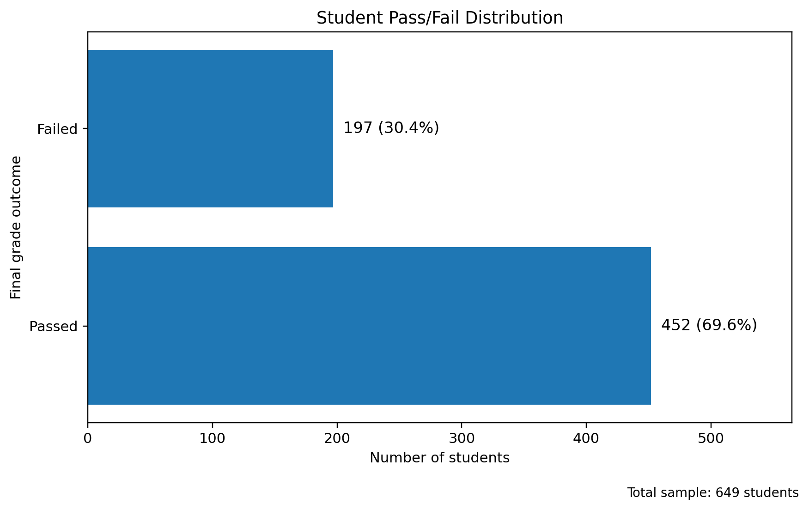

# Student Performance and Pass/Fail Analysis

## Project overview
A collaborative STAT305 Biostatistics Methods project studying factors associated with student academic performance. The report analysed records for 649 students.

## Research question
Which demographic, family, social and school-related factors are associated with a student's final pass/fail outcome?

## Data
The report describes 649 student records. Variables include gender, age, address, family size, parents' cohabitation status, parents' education and occupations, interest in higher education, internet access, health, school absences and final grade.

## Methods used
- Frequency tables for categorical variables
- Descriptive statistics for age and absences
- Chi-square tests of association
- Logistic regression using SAS
- Reduced-model selection
- Goodness-of-fit and overdispersion assessment
- Odds-ratio interpretation and predicted probabilities

## Selected findings reported
- 452 students (69.65%) were recorded as passing and 197 (30.35%) as failing.
- The report examined associations involving gender, address, internet access, interest in higher education and absences.
- A reduced logistic regression model was fitted after removing predictors identified as non-significant in the initial model.

## Tools
- SAS
- Logistic regression
- Statistical testing and descriptive analysis

## My contribution
This was a group university assignment. The report's contribution section lists me among the group members and identifies report-writing work within the group's contributions. It is presented here as collaborative academic work, not as a solo project.

## Limitations and notes
This repository currently documents the analysis described in the group report. The original dataset and complete executable SAS project files have not yet been added. Some interpretations and numerical statements in the source report may need checking against the original SAS output before being reused; this README therefore avoids presenting every reported odds ratio as a verified conclusion.

Results: Student Pass/Fail Distribution

The dataset contained 649 students. The analysis identified the following outcomes:

* Passed: 452 students (69.6%)
* Failed: 197 students (30.4%)

Key Findings

* Approximately 7 out of every 10 students passed.
* Approximately 3 out of every 10 students failed.
* The analysis explored demographic, family, educational and lifestyle-related factors associated with student performance.
* Logistic regression was used to investigate factors associated with passing or failing.

Tools and Statistical Methods

* SAS: Statistical analysis and data processing.
* Descriptive statistics: Summarising student characteristics and outcomes.
* Frequency analysis: Examining distributions of categorical variables.
* Chi-square tests: Exploring associations between categorical variables.
* Logistic regression: Modelling pass/fail outcomes.
* Model reduction: Comparing a reduced model with the full model.

Project Notes

This project was completed as part of a collaborative academic assignment. The results and code are presented for portfolio and learning purposes.
